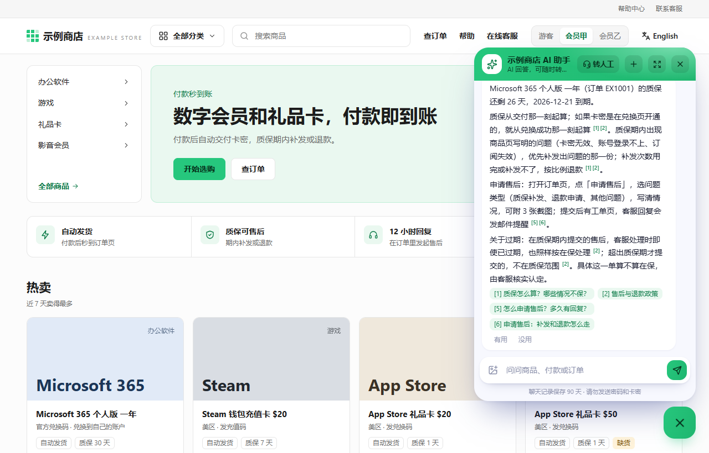
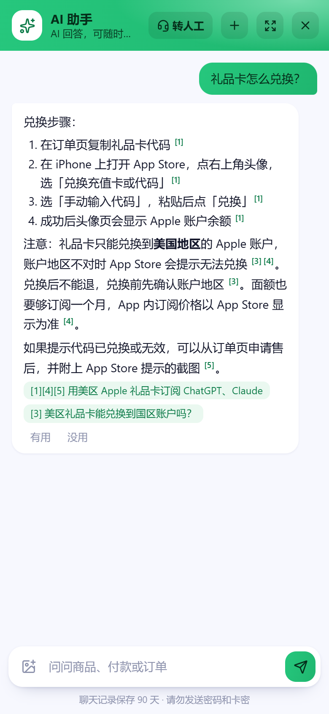
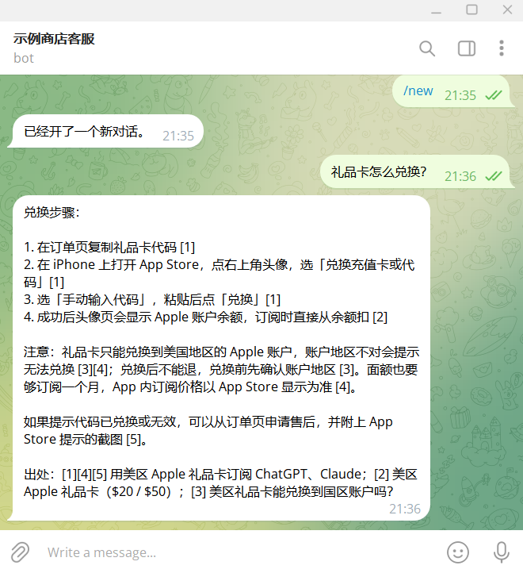
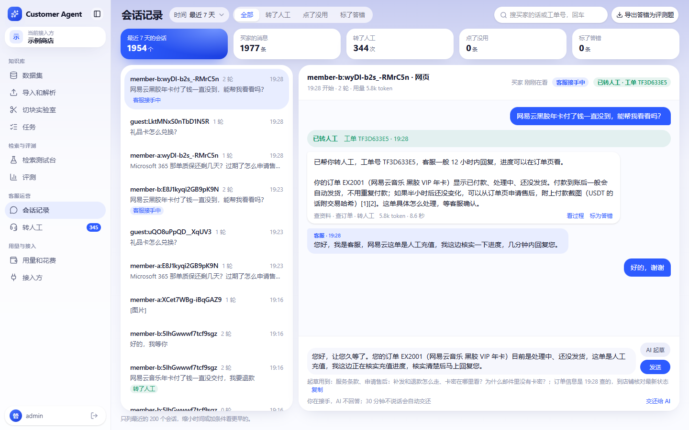
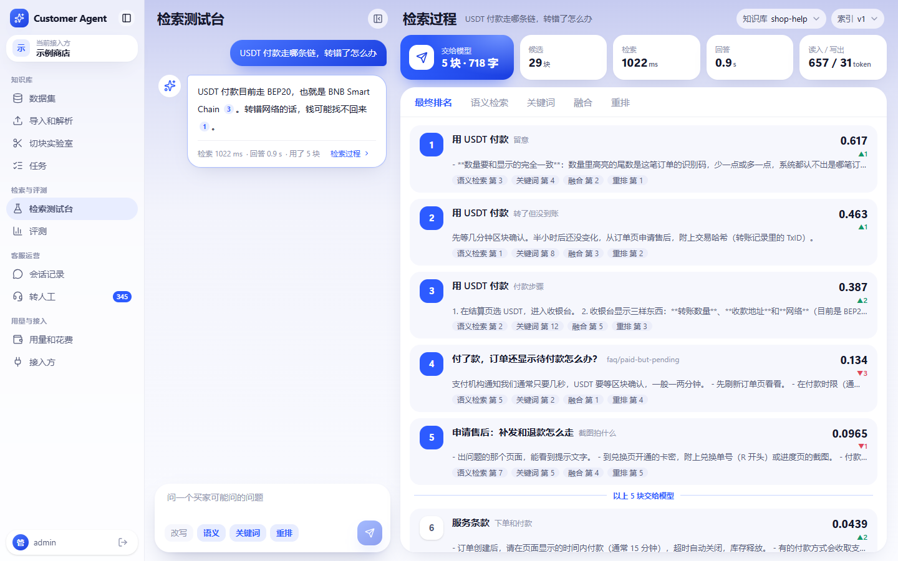
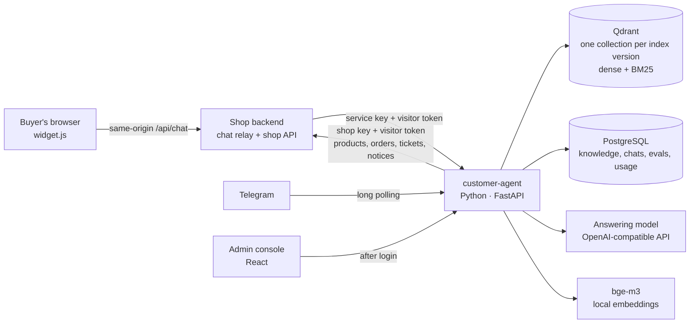

# customer-agent

English · [中文](README.md)

A general-purpose AI customer service you can host yourself and connect to any online shop.

Import the shop's help articles, policies and product descriptions into the knowledge base, and the AI answers buyers from that material with citations. When it needs live data, it asks the shop's API for products and the buyer's own orders. When a decision belongs to a person, such as a refund or a replacement, it hands off to a human; staff can take over in the admin console or let the AI draft a reply first.

Connecting a shop takes two steps: implement a small set of HTTP endpoints on your backend and add one script tag to your pages (see the [integration guide](docs/11-接入指南.md), in Chinese). The repository includes a mock shop, **Example Store**, so the whole flow runs without connecting a real shop.

> The documentation and admin UI are currently in Chinese. The chat widget supports Chinese and English.

| Chat widget on a phone | Telegram |
|---|---|
|  |  |

| Console: staff takeover with an AI draft | Console: rank of each chunk at every retrieval step |
|---|---|
|  |  |

More screenshots (full-page chat, evaluations, chunk lab, datasets, handoffs, usage) are in [docs/截图.md](docs/截图.md).

## Features

**AI customer service**
- Answers grounded in the knowledge base, with numbered citations. Prices, stock and order status come from the shop's API, never from the documents.
- Four tools: search knowledge, look up products, check the buyer's own orders, hand off to a human. The buyer's identity travels in a token signed by the shop, so the model cannot change it or see anyone else's orders.
- Guardrails in code: codes, passwords and one-time codes are masked before storage; limits per message, per visitor per day, per conversation and per shop per day; if the model claims it handed off without calling the tool, the code does it.
- Replies in the buyer's language.

**Human handoff and staff tools**
- With an order: a ticket is created in the shop. Without one: the buyer leaves an email and the shop owner is notified.
- Staff reply from the console while the AI stays quiet; they hand back to the AI, or it happens automatically after 30 minutes of staff silence.
- Reply copilot: one click drafts a reply, marking anything the shop must decide as **[to confirm]**.
- Buyers can send screenshots; images are re-encoded and stripped of metadata (the current model cannot read images, so they are for staff).

**Channels**: a web widget (one `widget.js` in a Shadow DOM; floating, full-page and mobile layouts) and a Telegram bot sharing the same conversation flow.

**Knowledge base and tuning**: import Markdown, TXT, HTML, Word and PDF with a human review step; bge-m3 dense + Qdrant BM25 retrieval fused with RRF, optional reranking and query rewriting; a chunk lab, a retrieval playground and two-level evaluations (retrieval and full conversations).

## Architecture

The browser never talks to the service directly: the service key stays on the shop's backend, and only the shop knows who the buyer is, so it signs a visitor token that the service hands back when it asks for orders.

**One message, end to end**: the shop's backend relays the message with its service key and the visitor token → the service checks the kill switch, limits and length, masks secrets and stores the message → the model gets the system prompt, the last 12 messages and the tools → it may search the knowledge base (dense + keyword, RRF, top 5 chunks numbered for citation) and look up the buyer's orders through the shop API (warranty days are computed in code) → the answer streams back as SSE with citations → code-level checks hand off if the model claimed to but didn't, or if it failed to answer twice in a row. At most 3 tool calls per turn; every retrieval stage is stored and viewable in the console.

**Retrieval**: chunks are cut by heading (400 characters, 40 overlap by default) and embedded with their "article › section" path. Each index version is its own Qdrant collection, so different chunking or embedding settings can coexist and be compared. The default recipe is dense + keyword; reranking is optional and off in production because it is slow on CPU. The measurements behind each choice are in [docs/05](docs/05-实测记录.md).

**Swappable parts**

| Part | Current | Where |
|---|---|---|
| Answering model | DeepSeek (`deepseek-flash`) | any OpenAI-compatible API via `LLM_BASE_URL` / `LLM_MODEL`; compare first with `agent chat-eval --model` |
| Embeddings | bge-m3, local | `rag/embedders.py` |
| Vector store | Qdrant | `rag/stores.py` |
| Reranker | bge-reranker-v2-m3 (optional) | `rag/rerankers.py` |
| Document parsers | built-in text, Docling, text-only PDF | `rag/parsers.py` |
| Shop | HTTP endpoints | `connectors/` |
| Channels | web widget, Telegram | `channels/` |

**Data and safety**: chats, retrieval traces and buyer images are deleted after 90 days; uploads and images are parsed in separate processes with timeouts; the admin console requires login with lockout. See [technical design §10](docs/02-技术方案.md).

## Measured

All measurements, with hardware and conditions, are in [docs/05-实测记录.md](docs/05-实测记录.md).

| Item | Result | Conditions |
|---|---|---|
| One retrieval | median 0.19 s | test server, 4-core Xeon, CPU only |
| Full answer | median 2.7 s | same, answering model `deepseek-flash` |
| Cost per answer | about ¥0.004 | at the provider's peak-hour price |
| Conversation-level evaluation | 93.8–96% pass | 80 questions incl. handoffs and adversarial ones |
| Whole deployment | within 3.5 GB RAM | Docker Compose, CPU only |

## Getting started

You need Python 3.12 with [uv](https://docs.astral.sh/uv/), Node.js with pnpm, PostgreSQL, [Qdrant](https://qdrant.tech/), and an API key for an OpenAI-compatible model (DeepSeek by default). The commands are in the [Chinese README](README.md#本地跑起来): configure `server/.env` and `demo/.env` from their examples, run migrations, download bge-m3 with `uv run agent fetch-model BAAI/bge-m3`, start the mock shop, sync and index its help articles, then start the service and the admin console and build the widget.

- **Deploy**: Docker Compose, see [docs/06-部署.md](docs/06-部署.md).
- **Connect your own shop**: implement 6 shop endpoints and 8 relay endpoints, then add one `<script>` tag. See the [integration guide](docs/11-接入指南.md); `demo/demo_shop/` is a working reference implementation.

## Status and limitations

- Under active development with no production users yet; APIs and schemas may change without compatibility shims.
- One deployment serves one shop.
- The answering model cannot read images; images sent by buyers are for staff.
- Telegram users cannot look up their orders (the shop does not know them); handoffs collect an email instead.
- Single process (the Telegram poller and daily cleanup run in-process); no multi-instance setup yet.

## Contributing

Issues and pull requests are welcome; see [CONTRIBUTING.md](CONTRIBUTING.md). Please report security issues privately as described in [SECURITY.md](SECURITY.md).

## License

[MIT](LICENSE)
