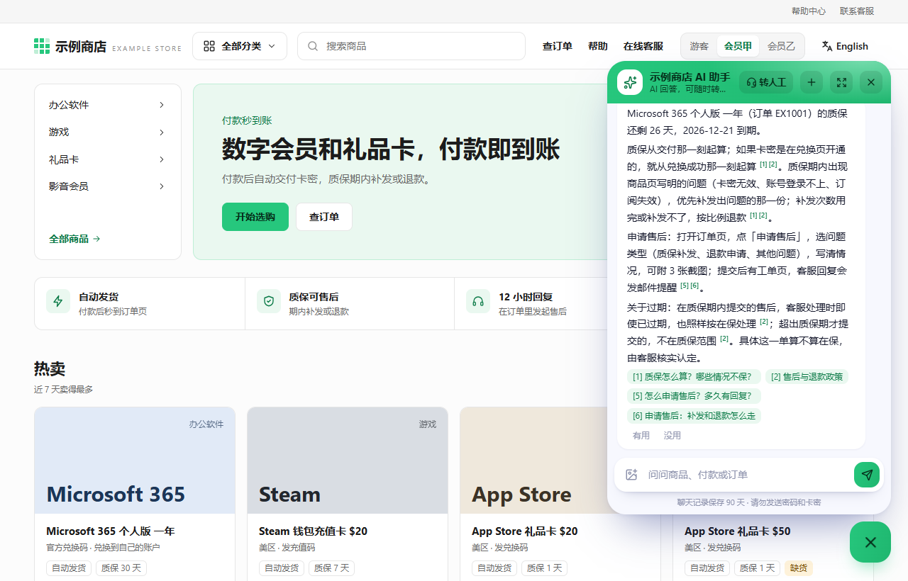
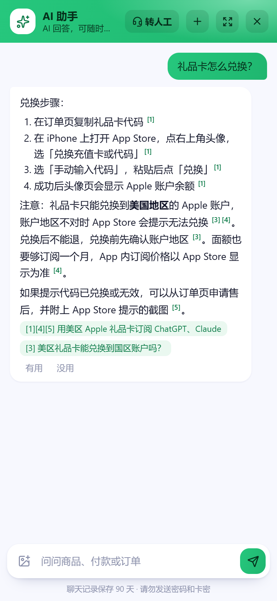
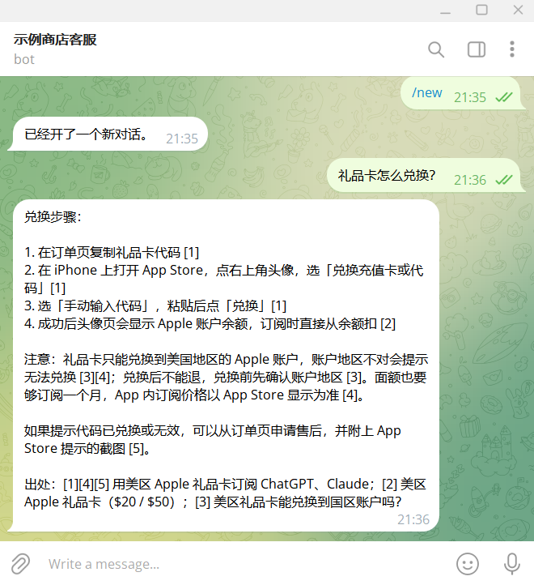
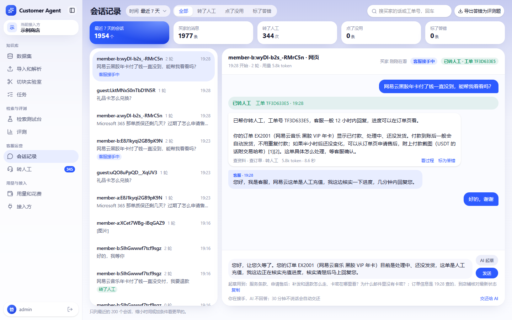
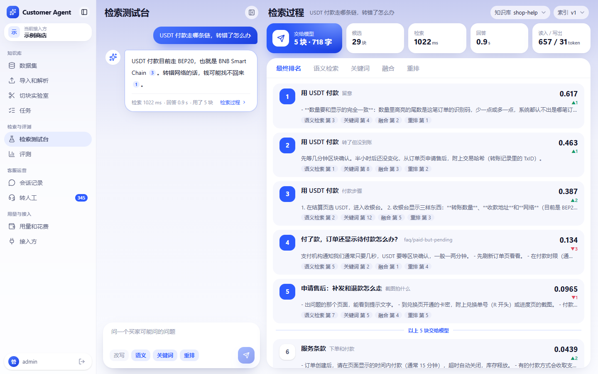
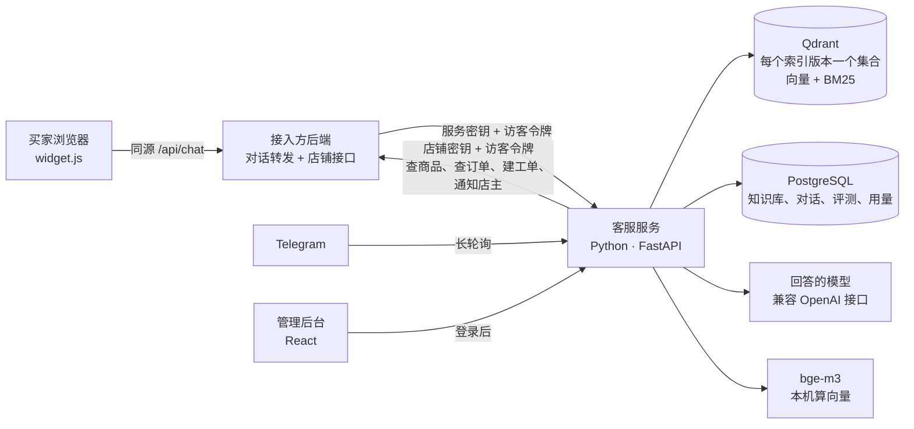
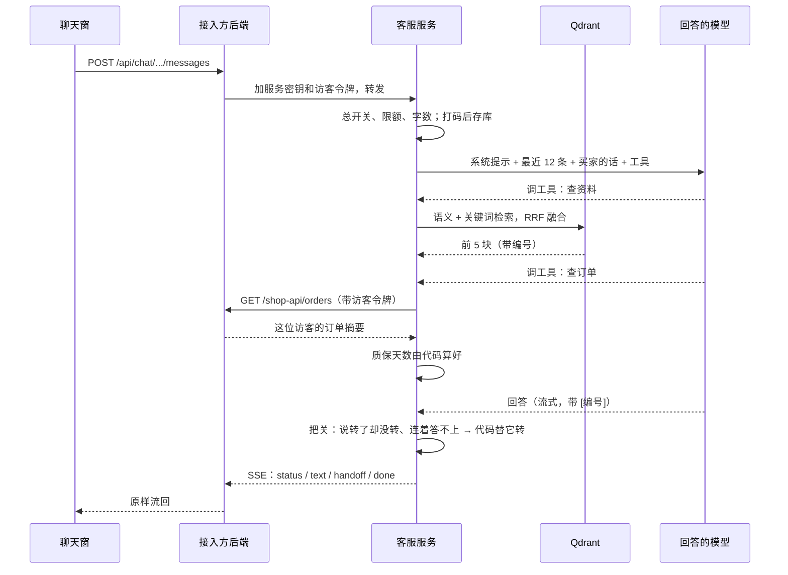
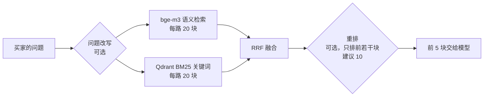

# customer-agent

[English](README.en.md) · 中文

一个通用的智能客服服务，可以自己部署，接入任何网店。

把店铺的帮助文章、政策和商品说明导进知识库，AI 就按这些资料回答买家的问题，并标出出处；需要实时信息时，它通过店铺接口查商品和买家自己的订单；遇到退款、补发这类要人拍板的事，就转给人工，客服可以在后台直接接手，也可以先让 AI 起草回复。

接入一家店只需要两步：店铺后端实现一组简单的 HTTP 接口，再在网页里放一段脚本，详见[接入指南](docs/11-接入指南.md)。仓库自带一个模拟店铺「示例商店」，不接任何真实店铺也能把整套流程跑起来。

[](LICENSE)



| 手机上的聊天窗 | Telegram |
|---|---|
|  |  |

| 后台：客服接手，AI 起草回复 | 后台：检索每一步各排第几 |
|---|---|
|  |  |

更多截图（整页版、评测、切块实验室、数据集、转人工、用量和花费）见 [docs/截图.md](docs/截图.md)。

## 能做什么

**AI 客服**
- 按知识库回答，句子后面标出处；价格、库存、订单状态调接入方的接口实时查，不从资料里猜。
- 四个工具：查资料、查商品、查自己的订单、转人工。访客身份由接入方签发的令牌带着，模型改不了，看不到别人的订单。
- 代码把关：卡密、密码、验证码入库前打码；单条字数、每人每天、每个对话、全店每天都有上限；模型嘴上说「转了」却没转时，代码替它转。
- 买家用什么语言问就用什么语言答。

**转人工和客服**
- 有订单的在店铺建工单，没订单的留邮箱、通知店主。
- 客服在后台直接回复买家，回复期间 AI 不插话；交还给 AI，或者 30 分钟不说话自动交还。
- 工单副驾驶：一键起草回复，要店铺拍板的地方标成【待确认】，客服改完再发。
- 买家可以发截图给客服；图片重新编码、去掉元数据（现在的模型看不懂图，图给人看）。

**渠道**
- 网页聊天窗：一个 `widget.js`，挂在 Shadow DOM 里，悬浮版、整页版、手机版，中英文。
- Telegram 机器人：私聊走同一套对话，客服的回复直接推过去。

**知识库和调优**
- 导入 Markdown、TXT、HTML、Word、PDF；解析结果人看过、改过再进库。
- 检索：bge-m3 语义 + Qdrant 关键词，RRF 融合；可选重排、问题改写。
- 切块实验室、检索测试台、两层评测（检索层和完整对话），每一步都看得见、能对比。

**管理后台**：数据集、导入和解析、切块实验室、任务、检索测试台、评测、会话记录、转人工、用量和花费、接入方设置。手机上也能用。

## 架构

### 组成



| 部分 | 做什么 | 技术 |
|---|---|---|
| 客服服务 `server/` | 对话、检索、导入、评测、后台接口、Telegram 渠道 | Python 3.12、FastAPI、SQLAlchemy 2、Alembic、sentence-transformers、Docling |
| 管理后台 `admin/` | 运营和调优的全部页面 | Vite、React、TanStack Router/Query、shadcn（Base UI）、Tailwind 4 |
| 聊天窗 `widget/` | 嵌进接入方网页的客服窗口 | React、Tailwind 4，打包成一个文件，Shadow DOM 隔离样式 |
| 模拟店铺 `demo/` | 一个完整的接入方参考实现，也是端到端测试的对象 | FastAPI、原生 JS 网页 |
| 存储 | 业务数据和向量分开 | PostgreSQL、Qdrant（自带 BM25 关键词检索） |

浏览器不直连客服服务：服务密钥只在接入方后端；买家是谁只有接入方知道，访客令牌由它签发，客服服务查订单时原样带回，由接入方判断能看什么。

### 一条消息怎么走



- 一轮最多调 3 次工具；用完后不再给工具，逼模型用已有内容回答。
- 每次检索的每一步（各路候选、融合、重排、交给模型的块）都存下来，后台「会话记录」和「检索测试台」能逐步看。
- 用量按天记账；到全店上限时聊天窗自动暂停，并通知店主一次。

### 检索链路



- 入库：按标题切块（默认 400 字、重叠 40），算向量时在正文前加「文章标题 › 小节标题」。每个索引版本是 Qdrant 里的一个集合，切块参数和向量模型不同就是不同版本，可以并存、对比。
- 默认配方是「语义 + 关键词」。重排在处理器上太慢（排 10 条要几秒），线上默认不开；为什么这样定、每一步值多少分，见[实测记录](docs/05-实测记录.md) §11–§12、§27。

### 可替换的部件

| 部件 | 现在用的 | 怎么换 |
|---|---|---|
| 回答的模型 | DeepSeek（`deepseek-flash`） | 任何兼容 OpenAI 接口的模型：改 `LLM_BASE_URL`、`LLM_MODEL`；换之前用 `agent chat-eval --model` 比一遍 |
| 向量模型 | bge-m3，本机算 | `rag/embedders.py` 加实现；建新索引版本时选 |
| 向量库 | Qdrant | `rag/stores.py` |
| 重排 | bge-reranker-v2-m3（可关） | `rag/rerankers.py` |
| 文档解析 | 自带（文本）、Docling（Word/PDF/HTML）、只取文字（PDF） | `rag/parsers.py` 里加一个解析器 |
| 接入方 | 按 HTTP 接口调 | `connectors/` 实现 `Shop` 接口 |
| 渠道 | 网页聊天窗、Telegram | `channels/` |

### 数据和安全

- **PostgreSQL**：知识库、文档、块、索引版本、导入文件、对话、消息、工具调用、检索过程、转人工记录、评测、每天用量、服务设置。时间一律带时区存，「今天」按业务时区算。
- **到期清理**：聊天记录、检索过程、买家发的图片 90 天后自动删。
- **隔离**：上传的文件和图片在单独的子进程里解析、清洗，带超时；查看原文件时带 `nosniff` 和 `sandbox`。
- **后台**：要登录，连续输错会锁定；接口定义和文档页不对外开放。
- 完整的安全清单见[技术方案 §10](docs/02-技术方案.md)。

## 实测

都在 [docs/05-实测记录.md](docs/05-实测记录.md) 里，写明了硬件和条件。几个代表性的数：

| 项 | 结果 | 条件 |
|---|---|---|
| 检索一次 | 中位 0.19 秒 | 测试服务器，4 核 Xeon，只用处理器 |
| 回答完 | 中位 2.7 秒 | 同上，回答模型 `deepseek-flash` |
| 每条回答花费 | 约 0.004 元 | 按官网高峰价 |
| 对话层评测 | 93.8%–96% 合格 | 80 题，含该转人工和刁钻题 |
| 整套部署 | 3.5GB 内存上限内 | Docker Compose，只用处理器 |

## 本地跑起来

需要：Python 3.12 和 [uv](https://docs.astral.sh/uv/)、Node.js 和 pnpm、PostgreSQL、[Qdrant](https://qdrant.tech/)，以及一个兼容 OpenAI 接口的模型密钥（默认 DeepSeek）。

```bash
# 1. 客服服务
cd server
cp .env.example .env          # 填数据库地址、模型密钥、后台密码、服务密钥
uv sync
uv run alembic upgrade head
uv run agent fetch-model BAAI/bge-m3          # 下载向量模型（约 2.3GB）并核对校验值

# 2. 模拟店铺（另开一个终端）
cd demo
cp .env.example .env          # 服务密钥要和 server 那边一样
uv run demo-shop serve --port 8100

# 3. 导入帮助文章、建索引、起服务
cd server
uv run agent sync shop-help shop              # 从模拟店铺的帮助文章接口同步
uv run agent index shop-help v1               # 打印「索引编号 N」：填进 demo/.env 的 INDEX_ID，重启模拟店铺
uv run uvicorn customer_agent.api:app --port 8000

# 4. 管理后台和聊天窗
cd admin && pnpm install && pnpm dev          # http://localhost:5175
cd widget && pnpm install && pnpm build       # 模拟店铺直接用 widget/dist/widget.js
```

打开 http://localhost:8100 是模拟店铺，右下角是聊天窗，右上角可以切换游客和两位会员。更多命令见 [CLAUDE.md](CLAUDE.md) 的「常用命令」。

## 部署和接入

- **部署**：Docker Compose 起 PostgreSQL、Qdrant、客服服务、管理后台（Caddy）和模拟店铺，见 [docs/06-部署.md](docs/06-部署.md)。
- **接到你自己的网店**：实现 6 个店铺接口和 8 个对话转发接口，再在页面里放一个 `<script>`，见[接入指南](docs/11-接入指南.md)。

## 文档

| 文档 | 内容 |
|---|---|
| [01 产品需求](docs/01-产品需求文档.md) | 给谁用、做什么、不做什么、验收标准 |
| [02 技术方案](docs/02-技术方案.md) | 选型、数据模型、接口、检索链路、对话、评测、安全 |
| [03 界面设计规范](docs/03-界面设计规范.md) | 后台、聊天窗、模拟店铺的设计；效果图在 `docs/admin-design/` |
| [04 路线图](docs/04-路线图.md) | 各期做了什么、接下来做什么 |
| [05 实测记录](docs/05-实测记录.md) | 每一步的测量、对比实验和踩过的坑 |
| [06 部署](docs/06-部署.md) | Docker Compose 部署和运维 |
| [07 人工接管](docs/07-人工接管方案.md) · [08 工单副驾驶](docs/08-工单副驾驶方案.md) · [09 发图片](docs/09-发图片方案.md) · [10 Telegram](docs/10-Telegram方案.md) | 各功能的方案 |
| [11 接入指南](docs/11-接入指南.md) | 把客服接进你自己的网店 |
| [截图](docs/截图.md) | 全部界面截图 |

## 现在的状态和限制

- 还在开发中，没有正式的生产用户；接口和表结构可能会变，不保证兼容。
- 一个部署对应一个接入方；多家店要各部署一套。
- 回答的模型看不懂图片；买家发的图只给人工客服看。
- Telegram 上的买家查不了自己的订单（接入方不认识他），转人工按留邮箱走。
- 服务是单进程的（Telegram 长轮询和每日清理都在进程里跑），还没做多实例。
- 文档和后台界面目前只有中文；聊天窗支持中英文。

## 参与

欢迎提 Issue 和 Pull Request，先看 [CONTRIBUTING.md](CONTRIBUTING.md)。发现安全问题请按 [SECURITY.md](SECURITY.md) 私下报告。

## 许可证

[MIT](LICENSE)
