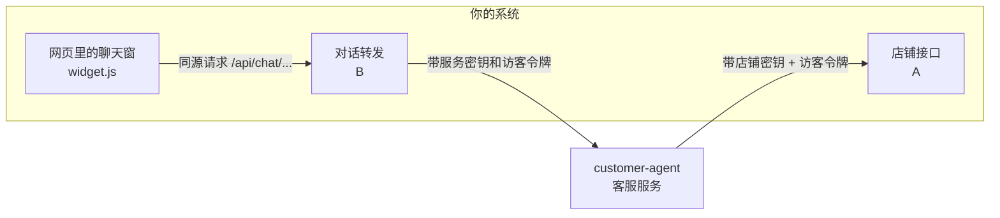

# 接入指南：把 customer-agent 接到你的网店

这份文档写给要把客服接进自己系统的开发者。照着做完，你的网店会有一个能按帮助文章回答、能查买家自己订单、能转人工的 AI 客服。

仓库里的模拟店铺（`demo/`）就是一个完整的接入方，下文的每个接口都能在 `demo/demo_shop/` 里找到可运行的参考实现：`shop_api.py`（店铺接口）、`relay.py`（对话转发）、`tokens.py`（访客令牌）。接口的完整定义在[技术方案 §5](02-技术方案.md)。

## 1. 总览：你要做三件事



| | 是什么 | 谁调谁 | 工作量 |
|---|---|---|---|
| **A. 店铺接口** | 6 个 HTTP 接口：店铺信息、帮助文章、商品、订单、建工单、通知店主 | 客服服务调你 | 小：多数是把已有数据换个形状吐出来 |
| **B. 对话转发** | 8 个 HTTP 接口：聊天窗的请求原样转给客服服务，加上密钥和访客令牌，检查会话归属 | 你的前端调你，你再调客服服务 | 小：参考实现约 150 行 |
| **C. 嵌入聊天窗** | 在页面里放一个 `<script>` | — | 几行 |

为什么要多一层转发、不让浏览器直接连客服服务：服务密钥不能出现在浏览器里；买家是谁只有你知道，访客令牌只能由你签发；会话归哪个浏览器也由你判断。

## 2. 准备

1. **部署客服服务**：按 [docs/06-部署.md](06-部署.md) 用 Docker Compose 起来。客服服务不需要对公网开放，只要你的后端能访问到它。
2. **两把密钥**（各生成一个足够长的随机串）：

   | 环境变量 | 方向 | 怎么用 |
   |---|---|---|
   | `SERVICE_API_KEY` | 你的后端 → 客服服务 | 调 `/v1/...` 时放在请求头 `X-Api-Key` |
   | `SHOP_API_KEY` | 客服服务 → 你的店铺接口 | 客服服务调你时放在请求头 `X-Api-Key`，你来核对 |

3. **告诉客服服务你的店铺接口在哪**：`SHOP_URL=https://你的后端内网地址`（不带 `/shop-api`）。

## 3. 访客令牌

访客令牌代表「这个浏览器里的这个买家」。你的对话转发在每次发消息、转人工时把它带给客服服务；客服服务查订单、建工单时原样放在请求头 `X-Visitor-Token` 里还给你，由你判断这位访客能看哪些订单。

- **格式你自己定**，客服服务不解析它，只是原样带回。建议用带过期时间的签名串，比如 HMAC，有效期十几分钟就够：转发每次请求都会重新签。
- **没登录的游客**也签一个（或者不带）：你在订单接口里对它返回空列表即可。
- 参考实现：`demo/demo_shop/tokens.py`，约 30 行，签的是 `{who, browser, exp}`。

模型永远拿不到也改不了这个令牌：它不在工具参数里，是代码带着走的。所以买家无论怎么问，都只能查到你允许他看的订单。

## 4. A. 店铺接口

所有请求都带 `X-Api-Key: <SHOP_API_KEY>`，核对不过回 401。和某位访客有关的接口还会带 `X-Visitor-Token`。客服服务的请求超时是 15 秒。

### `GET /shop-api/settings` 店铺信息

```json
{
  "name": "示例商店",
  "contacts": "Telegram：@example_support，邮箱：support@example.com",
  "reply_hours": 12,
  "online": true,
  "away_message": "现在是下班时间，客服每天 9:00–23:00 在线，上班后按顺序回复。"
}
```

`online` 是「现在是不是客服在线时间」，按你自己的营业时间算；不在线时，转人工的回复里会带上 `away_message`。

### `GET /shop-api/articles` 帮助文章

客服服务用它同步知识库（`agent sync <知识库> shop`）。

```json
[
  {"id": "faq/when-delivered", "lang": "zh", "title": "付款后多久能收到？", "kind": "faq", "markdown": "# 付款后多久能收到？\n\n自动发货的商品……"}
]
```

- `id` 是你这边的稳定编号，同一篇文章的各语言版本用同一个 `id`；回答里的出处会按它链回你的帮助页（见 §5 的 `source_url`）。
- `kind` 是分类，后台按它筛选，比如 `faq`、`guide`、`notice`、`page`、`product`。
- `markdown` 是正文。不要放只给内部看的内容：它会进知识库，可能被引用给买家。

### `GET /shop-api/products?q=关键词` 商品

```json
[{"name": "Microsoft 365 个人版 一年", "price": "¥398.00", "in_stock": true, "delivery": "自动发货"}]
```

价格、库存、交付方式这类实时信息只从这里来，不从文章里答。`q` 对不上任何商品时可以返回全部（让模型自己挑），也可以返回空。

### `GET /shop-api/orders` 这位访客的订单

带 `X-Visitor-Token`。没带、无效或是游客时返回 `[]`。

```json
[{
  "order_no": "EX1001",
  "product": "Microsoft 365 个人版 一年",
  "status": "已交付",
  "paid": true,
  "delivered": true,
  "warranty_until": "2026-12-21",
  "open_ticket": null
}]
```

- **只给摘要，绝不放卡密、完整邮箱、付款账号**：返回里没有的东西，模型想说也说不出来。
- `warranty_until` 是质保到期那天（`YYYY-MM-DD`），没交付时为 `null`；客服服务按它算「还剩几天 / 已过期」。
- `open_ticket` 是这张订单正在处理的工单号，没有就是 `null`。

### `POST /shop-api/orders/{order_no}/tickets` 建工单

带 `X-Visitor-Token`。请求体 `{"summary": "买家想解决什么、试过什么、相关状态"}`。

- 成功：`201 {"ticket_no": "T20260001"}`。
- 这位访客打不开这张订单：`403`。客服服务会改走「留邮箱」。

有订单的转人工都走这里，摘要由 AI 写好；客服在你自己的工单系统里回复。

### `POST /shop-api/notifications` 请你提醒店主

```json
{"kind": "handoff", "summary": "买家想开发票……", "conversation_id": "1f3c…", "email": "buyer@example.com"}
```

- `kind`：`handoff` 是没挂在订单上的转人工（买家留了邮箱，或者是会员但没说是哪张订单）；`daily_limit` 是今天的 AI 用量到了上限、聊天窗已暂停。
- 回 `204`。怎么提醒店主由你决定：后台通知、邮件、即时消息都行。
- 发送失败时，客服服务会在后台「转人工」页把这条标成「没通知到」，可以手动重发。

## 5. B. 对话转发

聊天窗只认这一组接口（默认挂在你网站的 `/api/chat` 下，和页面同源）。你做的事：加上服务密钥，加上访客令牌，检查「这个会话是不是这个浏览器的」，然后原样转给客服服务。

| 聊天窗调你 | 你转给客服服务 | 要做的 |
|---|---|---|
| `GET /api/chat/config` | `GET /v1/status` | 不是原样转：把客服服务回的开关、字数上限、常见问题，和你自己的店名、联系方式、主题色拼成配置（见下） |
| `POST /api/chat/conversations` | `POST /v1/conversations` | 请求体 `{"index_id": 你的索引编号, "visitor_id": "你定的访客编号", "channel": "web"}`；记下这个会话属于哪个浏览器 |
| `GET /api/chat/conversations/{id}?after=N` | `GET /v1/conversations/{id}?after=N` | 取历史；`after` 原样带上（转人工期间聊天窗每 5 秒用它拉客服的新回复） |
| `POST /api/chat/conversations/{id}/messages` | 同路径 `/v1/...` | 请求体加上 `visitor_token`；回的是 SSE，**流式原样转回**，别缓冲 |
| `POST /api/chat/conversations/{id}/images` | 同路径 `/v1/...` | multipart 的 `file` 原样转，表单里加 `visitor_token`；回的也是 SSE |
| `GET /api/chat/conversations/{id}/images/{image_id}` | 同路径 `/v1/...` | 原样转，带上 `Content-Type`、`Content-Security-Policy`、`X-Content-Type-Options` |
| `POST /api/chat/conversations/{id}/handoff` | 同路径 `/v1/...` | 买家点「转人工」；请求体加上 `visitor_token` |
| `POST /api/chat/conversations/{id}/messages/{mid}/feedback` | 同路径 `/v1/...` | 原样 |

**会话归属**：会话编号是随机的，但你仍要检查它属于当前浏览器（比如在你的库或缓存里记「会话 → 浏览器」），不是的话回 `404`。聊天窗收到 404 会自动开新会话。

**配置接口**返回给聊天窗的样子：

```json
{
  "enabled": true,
  "max_message_chars": 500,
  "suggestions": {"zh": ["付款后多久能收到？"], "en": ["How long does delivery take?"]},
  "name": "示例商店",
  "contacts": "Telegram：@example_support",
  "reply_hours": 12,
  "theme": {"brand": "#26c77d", "brand_deep": "#1fb66f", "brand_soft": "#eaf8f0", "brand_ink": "#0b7a47", "on_brand": "#052e1a"},
  "page_url": "/support",
  "source_url": "/help/{document}"
}
```

- `enabled`、`max_message_chars`、`suggestions` 来自 `/v1/status`（常见问题在客服后台「接入方」页改）。客服服务连不上时，把 `enabled` 设成 `false`，聊天窗只显示联系方式。
- `theme` 可以不给，默认蓝色。
- `page_url` 是整页版客服的地址，悬浮窗右上角的「放大」按钮跳过去。
- `source_url` 是出处链接的模板，`{document}` 会换成文章的 `id`。

**SSE 事件**（发消息、发图片的回答）：`user`（买家的话，已打码）、`status`（正在调哪个工具）、`text`（一段文字）、`clear`（撤掉已流出的文字）、`handoff`（转人工结果）、`done`（结束，带出处和消息编号）、`error`。转发时不用解析，原样转。如果前面有 Nginx 之类的反向代理，记得关掉响应缓冲（参考实现带了 `X-Accel-Buffering: no`）。

参考实现 `demo/demo_shop/relay.py` 用 FastAPI + httpx 写，约 150 行；换成别的语言是同样的几件事。

## 6. C. 嵌入聊天窗

先打包聊天窗（`cd widget && pnpm install && pnpm build`），把 `widget/dist/widget.js` 放到你的静态资源里。

**悬浮窗**（右下角一个按钮，点开是聊天窗），一行就够：

```html
<script src="/static/widget.js" data-base="/api/chat" data-mode="float"></script>
```

**整页版**，或者要自己控制什么时候挂：

```html
<div id="support" style="height: 80vh"></div>
<script src="/static/widget.js"></script>
<script>
  const chat = CustomerAgent.mount({ base: "/api/chat", mode: "page", target: document.getElementById("support"), lang: "zh" });
  // 不要了：chat.unmount()
</script>
```

- `base`：§5 那组接口的前缀，默认 `/api/chat`。
- `mode`：`float` 悬浮窗（默认），`page` 整页。窄屏上悬浮窗自动铺满。
- `lang`：`zh` 或 `en`，不给时按页面的 `<html lang>`。
- 聊天窗挂在 Shadow DOM 里，你的页面样式影响不到它，它也不影响你的页面。
- 更新 `widget.js` 时不改文件名的话，发文件时带 `Cache-Control: no-cache` 和 ETag，买家下次打开就是新的。

## 7. 知识库

1. 在客服后台建一个知识库，或者用命令行：
   - 从你的帮助文章接口同步：`uv run agent sync <知识库> shop`
   - 或者从文件夹同步 Markdown：`uv run agent sync <知识库> <文件夹>`
   - 或者在后台「导入和解析」页上传 Word、PDF，人看过再进库。
2. 建索引：`uv run agent index <知识库> v1`，打印的「索引编号」就是 §5 里的 `index_id`。
3. 文章改了以后再跑一次 `sync` 和 `index`，只会重做改过的文章。可以放进定时任务，或者在后台「数据集」页点「现在同步」。
4. 建议把常见问题攒成评测题（格式见 `evals/shop-help/questions.jsonl`），改提示词、换配方之前后都跑一遍 `agent eval` / `agent chat-eval`。后台「会话记录」里标了答错的回答可以一键导出成评测题。

## 8. 上线前检查

- [ ] 浏览器里看不到 `SERVICE_API_KEY`；客服服务和店铺接口都不直接对公网开放。
- [ ] 订单接口只返回摘要，没有卡密、完整邮箱、付款账号；游客返回空列表。
- [ ] 建工单时校验了订单属于这位访客，不属于就回 403。
- [ ] 对话转发检查了会话归属，别的浏览器打开会话回 404。
- [ ] SSE 没被反向代理缓冲：发一句话，文字是一段段出来的。
- [ ] 转人工的两条路都走过：有订单的建了工单；没订单的留邮箱，通知到了店主。
- [ ] 在客服后台「用量和花费」页设好每日上限和单价，「接入方」页填好常见问题。
- [ ] 把 `demo/e2e.py` 里的检查改成你的店铺数据跑一遍（它就是按上面这些点写的）。

## 9. 可选功能

- **客服直接回复**（[docs/07](07-人工接管方案.md)）：不用你做额外的事，只要历史接口把 `after` 带上了。
- **工单副驾驶**（[docs/08](08-工单副驾驶方案.md)）：在客服后台里用，不涉及接入方。
- **买家发图片**（[docs/09](09-发图片方案.md)）：转发 §5 表里的两个图片接口即可。
- **Telegram**（[docs/10](10-Telegram方案.md)）：客服服务直接和 Telegram 说话，不经过你；Telegram 上的买家你不认识，所以查不了订单，转人工走留邮箱。

## 10. 常见问题

**我的后端不是 Python，能接吗？** 能。所有交互都是 HTTP + JSON（回答是 SSE），参考实现只是用 Python 写的。

**一个客服服务能接几家店？** 现在一个部署对应一个接入方（一套 `SHOP_URL` 和密钥）。多家店就各部署一套，或者等「多接入方」做好（见路线图）。

**回答用的模型能换吗？** 能。任何兼容 OpenAI 接口的模型都行，改 `LLM_BASE_URL`、`LLM_MODEL` 和密钥。换之前建议用 `agent chat-eval --model` 先比一遍，提示词是照默认模型调的。

**买家的数据存多久？** 聊天记录、检索过程和买家发的图片 90 天后自动删除（`agent cleanup` 也能手动清）。入库前卡密、密码、验证码会打码。
