# 截图

都在模拟店铺「示例商店」里实际操作截的，图片在 [`docs/images/`](images/)。

## 网页聊天窗

**悬浮窗**：会员问质保和售后，AI 查了订单和帮助文章，句子后面标出处。

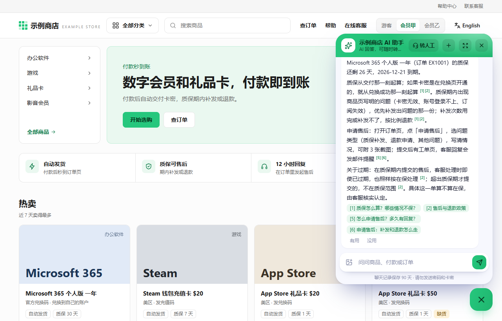

**手机**：窄屏上铺满；出处可以点开看原文。

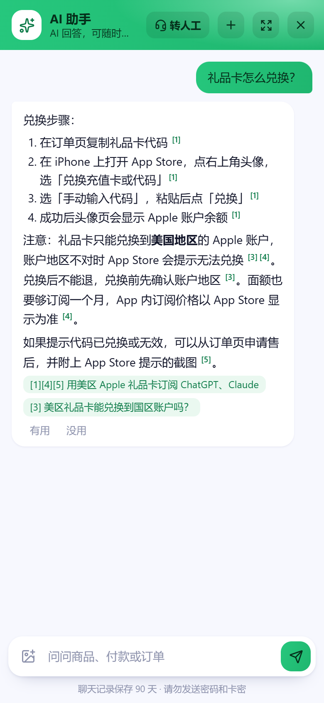

**整页版**：接入方可以给客服单独一个页面。

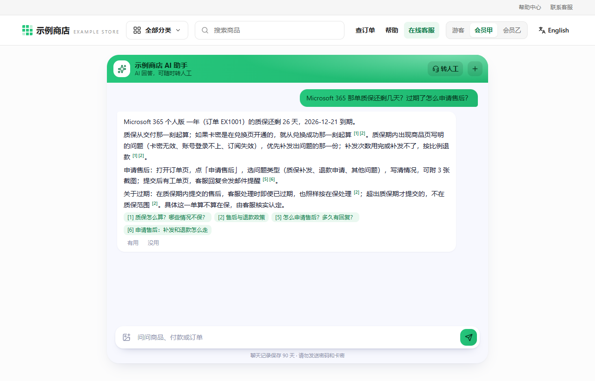

**客服接手**：转人工后客服在后台回复，买家几秒内看到；客服在接时 AI 不插话，输入框提示「发给客服」。

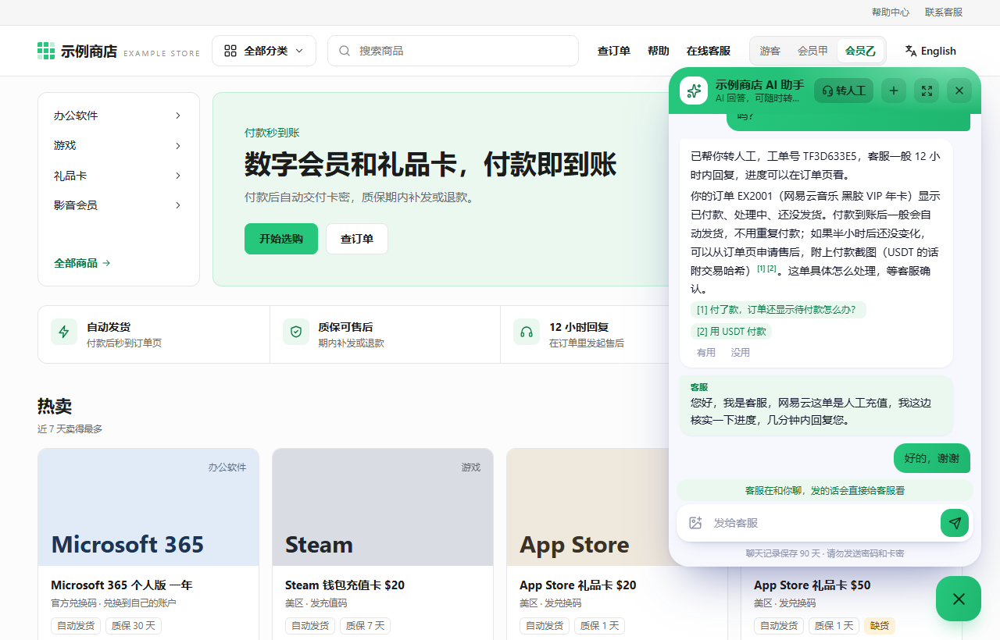

## Telegram

同一套对话接到 Telegram：常见问题按钮、出处、转人工、客服回复直接推过去。

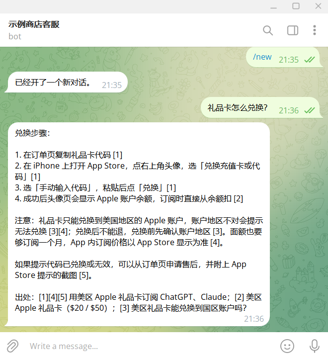

## 管理后台

**会话记录**：每一轮查了什么资料、调了哪些工具、花了多少 token；客服直接回复，「AI 起草」按对话、资料和订单生成草稿，拿不准的地方标【待确认】。

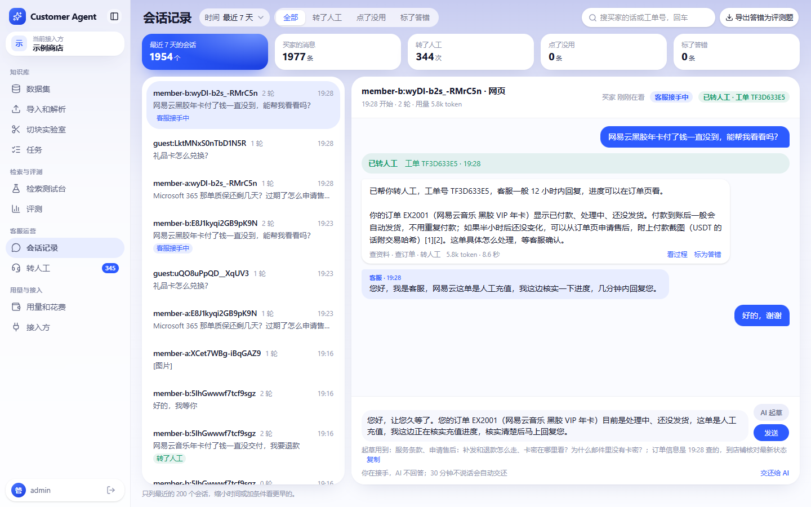

**检索测试台**：语义、关键词、融合、重排每一步各排第几，重排前后名次怎么变。

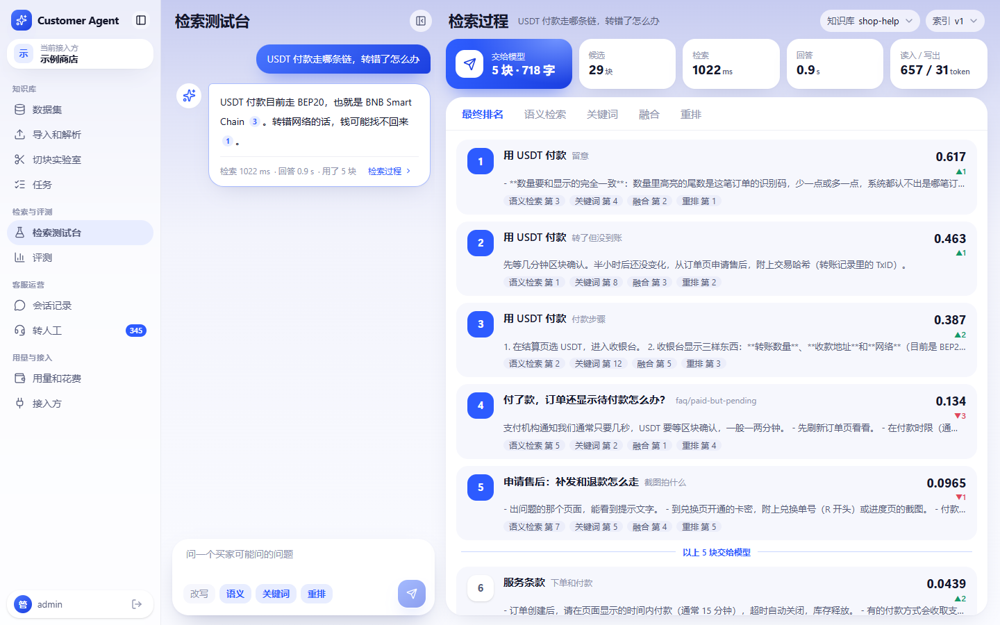

**评测**：两次评测逐题对比，看哪些题变好、哪些变差。

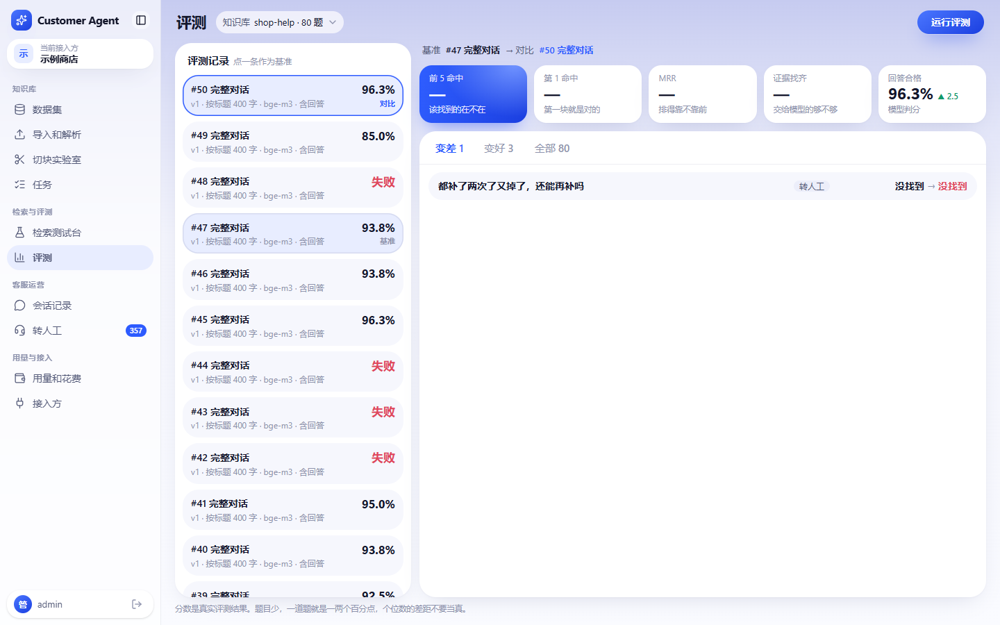

**切块实验室**：拖滑块实时看一篇文章怎么切，和在用的版本比块数、长度。

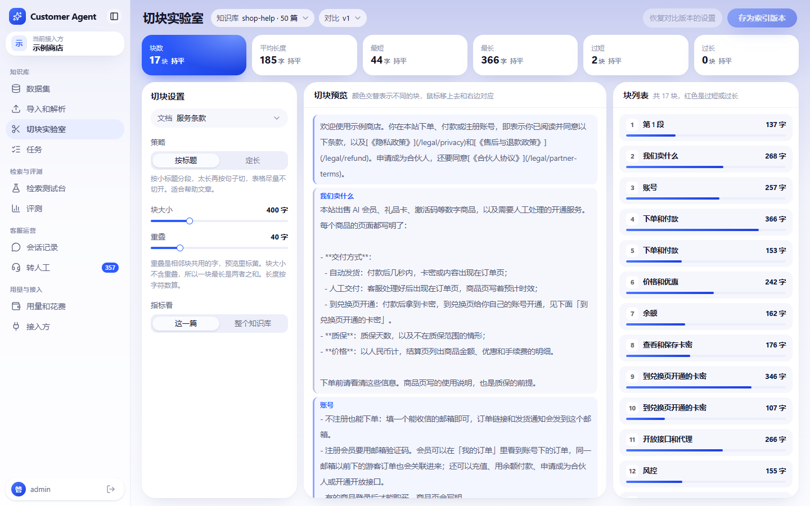

**数据集**：原文和切出来的块左右对照，点块跳到原文位置。

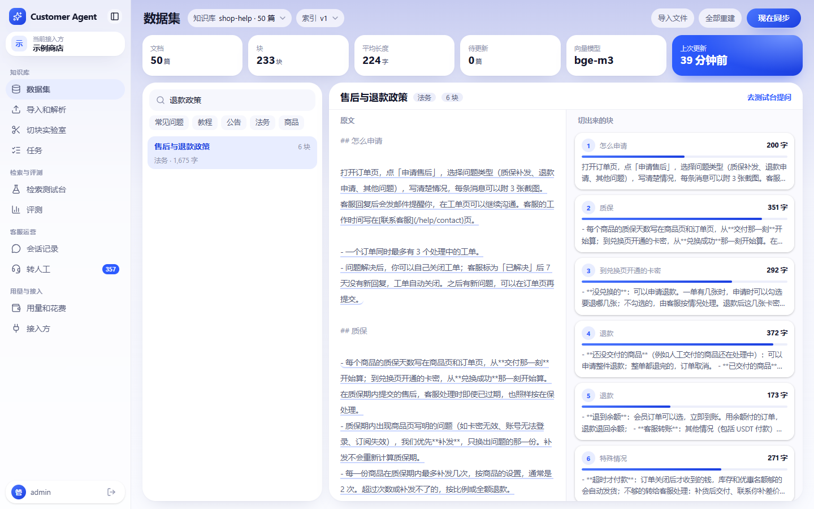

**转人工**：待处理、没通知到店铺、已处理；左侧菜单显示待处理条数。

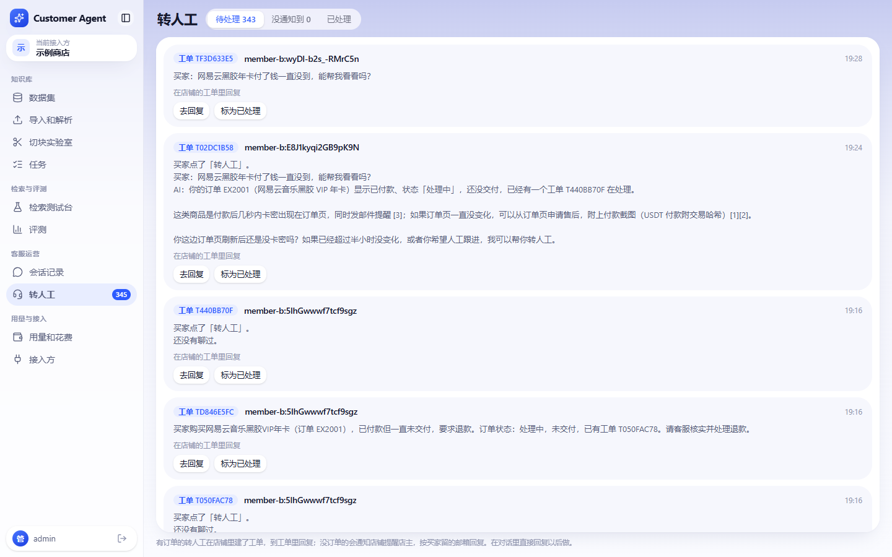

**用量和花费**：每天用量、估算花费、总开关和各项限额。

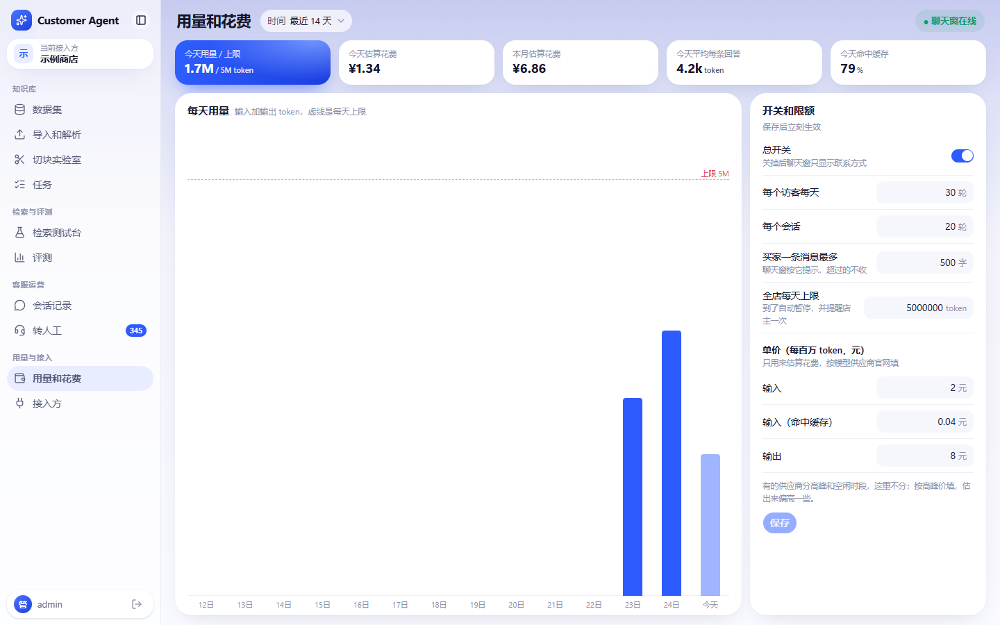
